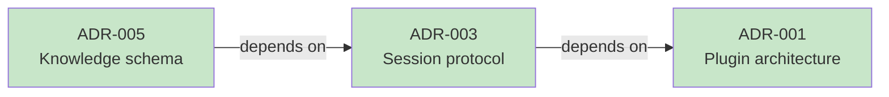

# /ezra:decide-graph — Decision Dependency Graph

## Purpose
Read every `.ezra/decisions/ADR-*.yaml` file and render the relationships between
decisions as a dependency graph. Used to understand the decision history at a
glance, identify superseded decisions, and spot decisions that reference other
decisions (via `supersedes`, `depends_on`, or `related_to` fields).

## Usage
```
/ezra:decide-graph                — ASCII tree view of all ADRs with status
/ezra:decide-graph --mermaid      — Render as Mermaid diagram (copy-paste into markdown)
/ezra:decide-graph --active       — Only show ACTIVE decisions (hide SUPERSEDED/DEPRECATED)
/ezra:decide-graph --orphans      — Only show decisions with no incoming/outgoing edges
/ezra:decide-graph <ADR-id>       — Show the sub-graph rooted at a specific ADR (ancestors + descendants)
/ezra:decide-graph --export <path> — Write the graph as JSON to <path>
```

## Behavior

If `.ezra/` does not exist, tell the user to run `/ezra:init` first and stop.

### 1. Load all decisions
Read every file matching `.ezra/decisions/ADR-*.yaml`. Parse each as YAML and
extract:
- `id` (e.g. `ADR-007`)
- `status` (`ACTIVE` | `SUPERSEDED` | `DEPRECATED` | `PROPOSED`)
- `date`
- `category`
- `decision` (the headline sentence)
- Relationship fields:
  - `supersedes` — this ADR replaces another (edge: this → target)
  - `superseded_by` — this ADR has been replaced (edge: target → this)
  - `depends_on` — soft dependency on another ADR
  - `related_to` — informational cross-reference

### 2. Build the graph
Nodes = ADRs. Edges = relationships. Each edge has a type:
- `supersedes` (solid, labelled "supersedes")
- `depends_on` (dashed, labelled "depends on")
- `related_to` (dotted, labelled "related")

### 3. Detect orphans
An ADR is an orphan if it has zero edges (no relationships to any other ADR).
Orphans are not bad — they are stand-alone decisions — but the `--orphans`
filter makes them easy to spot for review.

### 4. Render

#### ASCII mode (default)
```
ADR-001 [ACTIVE] Plugin architecture for MCP servers
  │
  └── ADR-003 [ACTIVE] depends_on
         │
         └── ADR-005 [ACTIVE] depends_on

ADR-004 [ACTIVE] Zero-dependency constraint
  │  (no dependencies)

ADR-006 [ACTIVE] Multi-agent orchestration with 100-role registry
  │
  └── ADR-008 [ACTIVE] supersedes v5 F12 Custom Rule Engine

ADR-007 [ACTIVE] EZRA distributes via GitHub releases, not NPM
  │  (no dependencies)
```

#### Mermaid mode (`--mermaid`)
Output a fenced ```mermaid block with a `graph LR` flowchart that the user
can paste into any markdown renderer. Use `[ADR-001]` style nodes, edge
labels for `supersedes` / `depends_on` / `related_to`, and colour-code by
status (green=ACTIVE, yellow=PROPOSED, grey=SUPERSEDED, red=DEPRECATED).

Example output:


#### JSON export (`--export <path>`)
Write the following structure to `<path>`:
```json
{
  "generated": "2026-04-09T00:00:00.000Z",
  "nodes": [
    { "id": "ADR-001", "status": "ACTIVE", "date": "2026-01-15", "category": "ARCHITECTURE", "decision": "..." }
  ],
  "edges": [
    { "from": "ADR-003", "to": "ADR-001", "type": "depends_on" }
  ],
  "orphans": ["ADR-004", "ADR-007"],
  "stats": {
    "total": 8,
    "active": 7,
    "superseded": 1,
    "orphans": 2
  }
}
```

### 5. Summary footer
After rendering, print a one-line summary:
```
8 ADRs | 7 active | 1 superseded | 2 orphans | 3 supersede edges | 0 depends_on edges
```

## Data Source
- `.ezra/decisions/ADR-*.yaml` — input
- `.ezra/decisions/.graph-cache.json` — optional cache for large ADR sets (rebuild on staleness)

## Cross-References
- `/ezra:decide` — record a new ADR
- `/ezra:status` — governance state overview including ADR count
- `/ezra:reconcile` — plan vs. implementation reconciliation

## Implementation Notes
- Pure read-only command, no state mutations
- Uses built-in YAML parsing via `hooks/ezra-yaml-utils.js` (already present)
- Mermaid output does not require any npm dependency; it's plain text that
  renders in any markdown viewer
- For very large ADR sets (>50 decisions), the ASCII view truncates sub-trees
  with `... (N more)` to keep output readable; `--export` always emits the
  full graph
